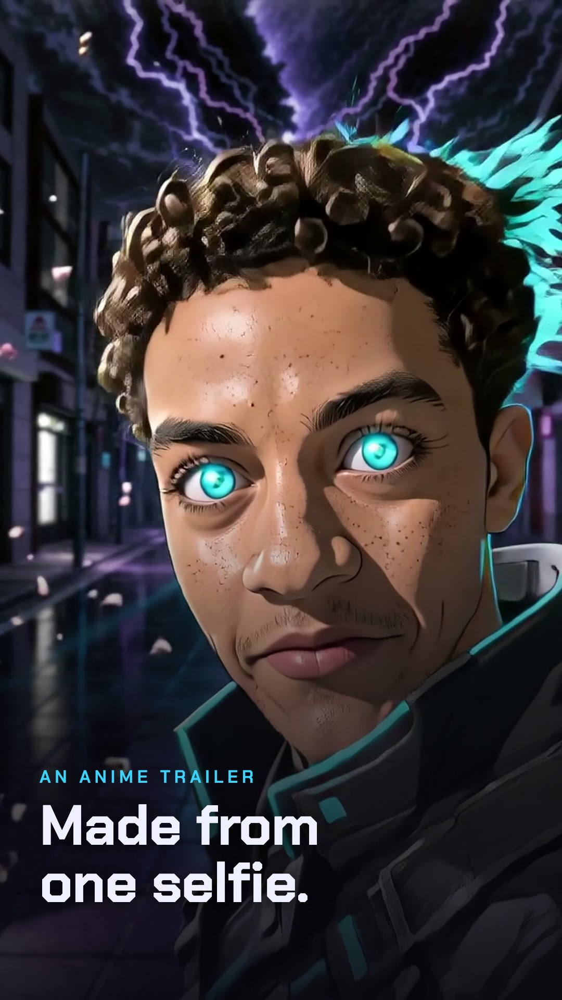
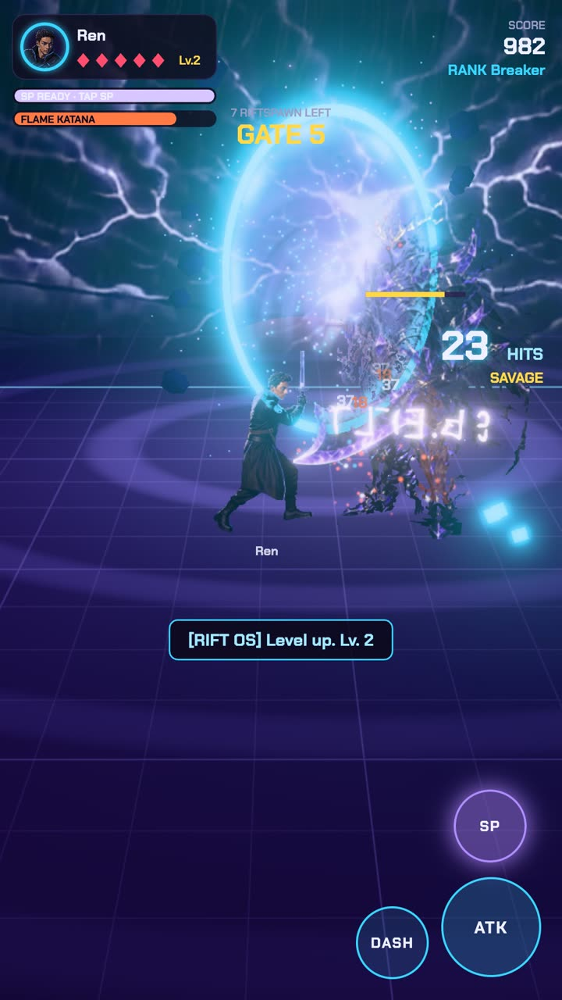
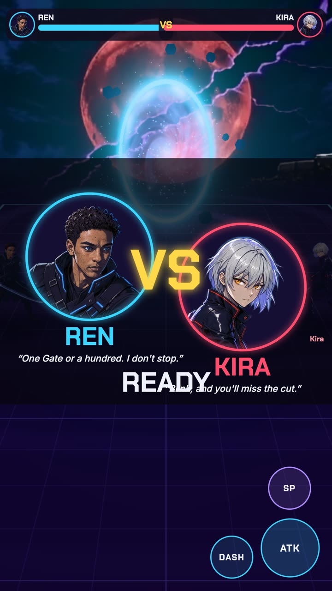
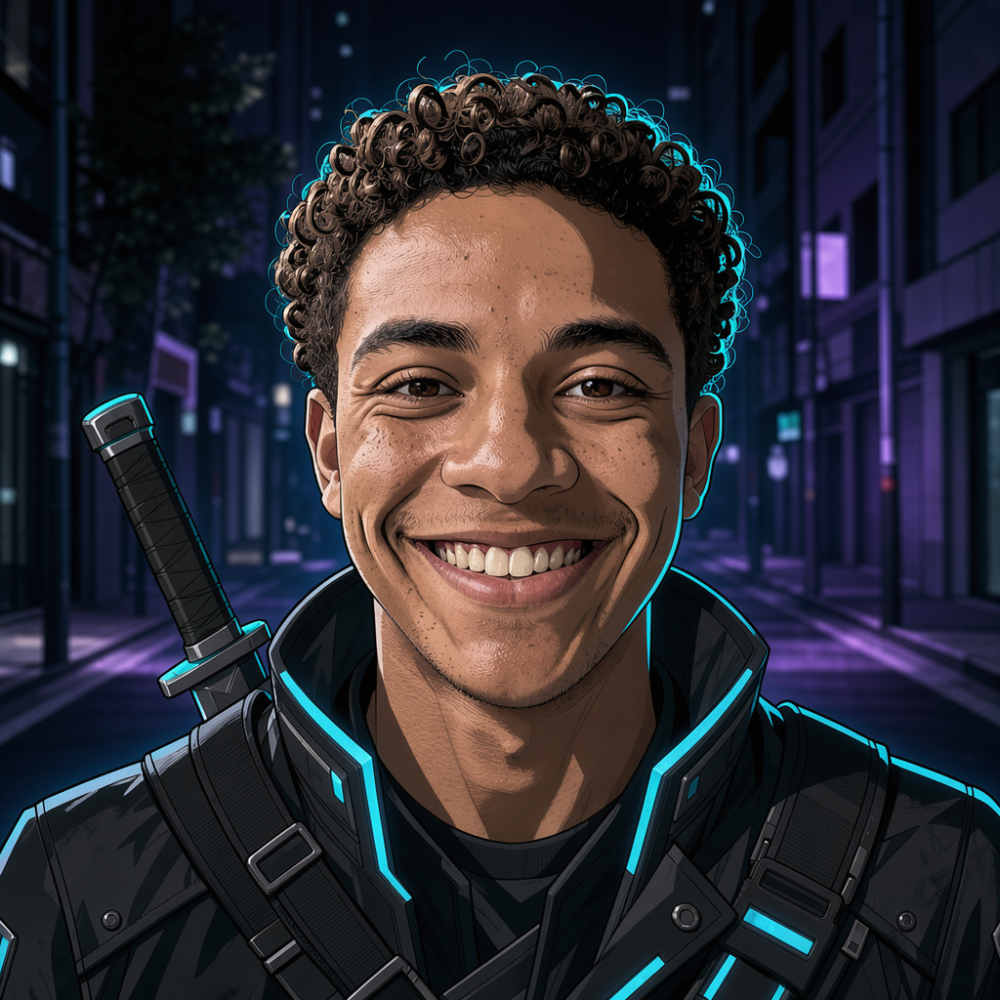
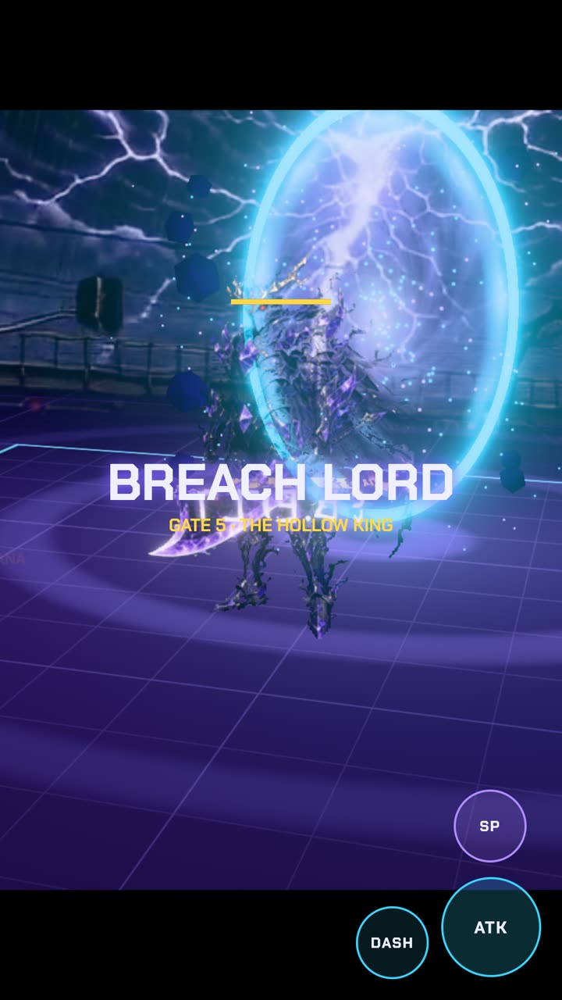
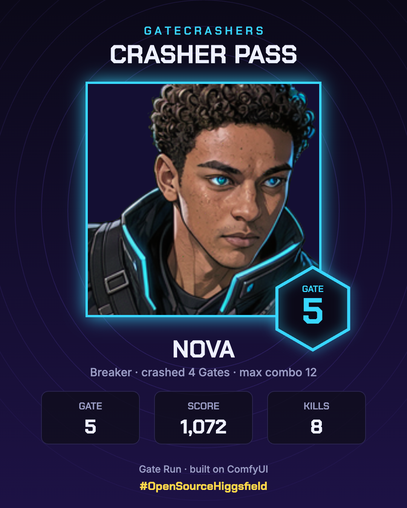

# Gate Run

### One selfie. Your own anime trailer. A fighter you play. How many Gates can you crash?

<p align="center">
  <a href="https://luciddreamcenter1-design.github.io/gate-run/media/launch.mp4"></a>
  &nbsp;
  
  &nbsp;
  
</p>

<p align="center">
  <b><a href="https://luciddreamcenter1-design.github.io/gate-run/app/">▶ Play free</a></b> ·
  <a href="https://luciddreamcenter1-design.github.io/gate-run/">Project page</a> ·
  <a href="https://luciddreamcenter1-design.github.io/gate-run/media/launch.mp4">Watch the 21 s launch video</a> ·
  <a href="https://luciddreamcenter1-design.github.io/gate-run/media/demo.mp4">Demo: how it works (1:44)</a>
</p>

Built for Comfy's **#OpenSourceHiggsfield** contest. It's an open-source answer to the paid "put yourself in the shot" apps, and it goes further: you don't only get a clip of yourself, you get to *play* as yourself.

## The idea

Filmmakers make one film. Gate Run makes one for every player.

You take a selfie. A minute later you're a manhwa-style Gatecrasher with a three-shot anime trailer where a narrator says your name. Then a Gate tears open and you fight through it, as you: the full-body character on screen, every swing, dash and special, was animated by LTX-2 from your picture. The Gates keep coming, each harder than the last, with a Breach Lord every fifth one. When you fall, you get a Crasher Pass card and a one-tap vertical Reel of your trailer and your run, ready to post. Then you send a friend a link and settle it 1v1.

No selfie, no credits, no problem: four original Crashers (Ren, Kira, Brann and Vex) ship with full LTX-animated movesets and voiced lines, so anyone can play from the link for free, on a phone, iPad or desktop.

## What's in it

| | |
|---|---|
| **Selfie to Crasher** | FLUX 3 on Comfy Router redraws you as a semi-realistic manhwa hero who still looks like you. |
| **Your anime trailer** | FLUX 3 keyframes, then **LTX-2 image-to-video + camera LoRA** (a ComfyUI workflow on Comfy Cloud) animates three shots with sound. An ElevenLabs narrator says your name and FLUX Video Upscale finishes it at 1056×1920. The browser edits it with title cards, grade, grain and letterbox. |
| **Play as yourself** | FLUX 3 draws your full body on green and LTX-2 animates five moves. The browser keys the green, trims the frames and bakes sprite sheets. It takes about 3.5 minutes from selfie to playable you. |
| **Real combat** | 3-hit combos with aim assist, dash i-frames, a special meter, hit-stop, juggles, enemy telegraphs, weapon drops, and boss entrance cinematics. Runs at 60 fps on phones. |
| **Online 1v1** | Send a link and fight live, peer-to-peer over WebRTC with no game server. VS splash, K.O. cinematic, and a shareable victory card. |
| **Arenas** | Four living arenas (FLUX 3 paintings animated by LTX-2), or upload a photo of your place and ComfyUI turns it into a battleground. |
| **Made to share** | Crasher Pass card, a one-tap 1080×1920 Reel, a victory card, and the dare in every caption: *How many Gates can you crash?* |

| Selfie | Crasher (FLUX 3) | Trailer shot (LTX-2 + LoRA) | Boss Gate | Crasher Pass |
|---|---|---|---|---|
|  |  | [media/trailer_shot.mp4](media/trailer_shot.mp4) |  |  |

*The demo face is AI-generated (a fictional person).*

Full spec: [SPEC.md](SPEC.md) · Demo video script: [DEMO_SCRIPT.md](DEMO_SCRIPT.md)

---

## Run it (5 minutes)

```bash
git clone <this repo> && cd gate-opening
pip install -r requirements.txt          # comfy-sdk (optional for Router, needed for Cloud)
echo "COMFY_API_KEY=comfyui-..." > .env  # key from platform.comfy.org/profile/api-keys
python3 server.py
```

Open **http://localhost:8080**. The badge on the start screen shows which Comfy route is connected.

No key and no ComfyUI? The game still runs in **preview mode** (in-browser toon filter, built-in Gate), so anyone can play from a link. Open `app/index.html` from any static host.

## Put it online (full version, about 5 minutes)

[](https://render.com/deploy?repo=https://github.com/luciddreamcenter1-design/gate-run)

1. Click the button and sign in to Render. When it asks for `COMFY_API_KEY`, you can **leave it blank to host for free**: everyone plays the shipped roster, arenas and 1v1, and visitors who add their own Comfy key get the personal selfie pipeline on their own credits. If you do paste a key, it stays in Render's settings and is never in the repo.
2. Render builds from `render.yaml` and gives you an `https://…onrender.com` link that works on phones (camera upload, share sheet).

How credits work on a public link:
- **Free tier on your key:** each visitor gets `FREE_JOBS_PER_IP` generation steps per day (default 14, about one Crasher with a quick 1-shot trailer and their own animated moveset). There's also a global daily cap, `FREE_JOBS_PER_DAY` (default 600). You can change both in Render.
- **Their own key:** visitors can tap "Use my own Comfy key". The key is stored only in their browser, sent with their own requests, and used for their jobs only. It's never logged or stored on the server. That unlocks the full 3-shot trailer and removes the limits.

The free GitHub Pages link above stays up too, as the no-key guest version.

## How generation is routed

`server.py` takes each job (portrait or clip) down a route list and uses the first one that works. If a route fails (out of credits, provider down, missing model), it moves on to the next one. Comfy Router also switches serving providers on its own.

| Stage | Route order (default) |
|---|---|
| Portrait | `router:bfl/flux-3-image` → `router:bfl/flux-kontext-pro` → `local:hunter_portrait_api.json` |
| Gate clip / trailer shots | `cloud:gate_clip_ltx2_lora_api.json` → `cloud:gate_clip_ltx25_api.json` → `local:gate_clip_ltx25_api.json` → `local:gate_clip_api.json` → `router:ltx/ltx-2-5-fast` |
| Trailer keyframes | `router:bfl/flux-3-image` → `router:bfl/flux-kontext-pro` |
| Narrator | `router:elevenlabs/eleven_v3` → `router:elevenlabs/eleven_multilingual_v2` |
| Finishing | `router:bfl/video-upscale-v1` (1.5× to 1056×1920) |
| Full-body keyframe | `router:bfl/flux-3-image` → `router:bfl/flux-kontext-pro` |
| Moveset (sprite animation) | `cloud:moves_ltx2_api.json` → `local:moves_ltx2_api.json` |

- **`router:`** [Comfy Router](https://docs.comfy.org/development/comfy-router/quickstart) at `api.comfy.org/v2/models`. Uses `comfy-sdk` when installed, plain HTTP (standard library) otherwise.
- **`cloud:`** runs a workflow from `workflows/` on **Comfy Cloud** through `comfy-sdk` (open weights and LoRAs on RTX 6000 Pro).
- **`local:`** runs the same workflow on your own ComfyUI (`COMFY_URL`, default `http://127.0.0.1:8188`). Partner nodes (the LTX 2.5 API) bill your Comfy account through the same key.
- Router's LTX is text-to-video only, so that last-resort route renders an empty Gate plate and the page composites your Crasher in front of it.

Override any list with `PORTRAIT_ROUTES`, `CLIP_ROUTES`, `KEYFRAME_ROUTES`, `VOICE_ROUTES` or `UPSCALE_ROUTES` (comma-separated), either in the environment or in `.env`.

### Animate your own characters
`workflows/moveset.json` lists every character (the player's Crasher, imp, brute, boss): one full-body keyframe prompt each, plus an LTX motion prompt per move. `workflows/moves_ltx2_api.json` is the LTX-2 graph with the camera LoRA off, so the camera stays locked for sprite work. The shipped cast lives in `app/sprites/`. To regenerate it, render the clips into `app/sprites/src/`, then run `python3 tools/bake_sprites.py` (needs ffmpeg). That script keys the green, trims the frames where LTX holds still, tiles 12 fps sheets, and measures foot anchors.

### Direct your own trailer
`workflows/trailer.json` is the shot list: per shot, a FLUX keyframe prompt, an LTX motion prompt, the title card, and the in/out points used in the edit, plus the narration line and voice. Edit it and the next player gets your cut; no code changes needed.

Measured on the real services:

| Step | Time |
|---|---|
| Portrait (FLUX 3 via Router) | about 55 s |
| Each trailer keyframe (FLUX 3) | about 55 s |
| Each LTX-2 + LoRA shot (Comfy Cloud, 704×1280, 121 frames at 24 fps, AAC audio) | 35–65 s |
| Upscale | about 70 s |
| Narrator | about 3 s |

All three shots run in parallel while you play.

## The workflows (ComfyUI API format)

| File | What | Runs on |
|---|---|---|
| `gate_clip_ltx2_lora_api.json` | LTX-2 19B image-to-video, distilled LoRA + **camera dolly-in LoRA**, two-stage with latent upscale, audio. Converted from the official ComfyUI template; the Crasher image is applied in both sampling stages so identity holds. | Comfy Cloud / big local GPU |
| `gate_clip_ltx25_api.json` | LTX 2.5 image-to-video partner node | Any ComfyUI with a Comfy key (even a laptop) |
| `gate_clip_api.json` | LTX-Video 0.9.5 image-to-video (small, local) | Local GPU |
| `hunter_portrait_api.json` | FLUX.1 Kontext dev edit; also the source of the portrait prompt | Local GPU |

The app finds nodes by **title**, so any graph works:

| Title | Put it on |
|---|---|
| `IN_SELFIE` | LoadImage for the selfie (portrait) |
| `IN_IMAGE` | LoadImage for the Crasher (clip) |
| `IN_PROMPT` | the positive CLIPTextEncode |
| `IN_SEED` | sampler / RandomNoise (randomized each run) |
| `IN_LORA` | LoRA loader(s), to swap LoRAs |
| `OUT` | the final save node |

Build or open a workflow in ComfyUI, set the titles, **Workflow → Export (API)**, and save it into `workflows/`. LTX must stay the core video model to qualify for the LTX VFX bonus.

## Game

- `app/index.html`: game logic, UI, audio mix, cinematics, Crasher Pass (canvas 2D HUD on top)
- `app/director.js`: the in-browser editor. It plays a timeline of shots, cards and images with a film finish and records it to MP4/WebM (MediaRecorder). The trailer and the Reel both use it.
- `app/audio/`: sound effects, music loop and narrator lines, generated once with ElevenLabs through Comfy Router, so they work even in preview mode
- `app/world3d.js`: three.js renderer (vendored in `app/vendor/`, no build step). It covers the ground grid shader, swirl-noise portal, night-city skyline, bloom, 3D Riftspawn, and your portrait as the Crasher's head. Without WebGL 2 the page falls back to the 2D renderer.
- Controls: WASD to move, J or click to slash (press three times for the combo), Space / K to dash, L / E or right-click for the special. On touch: drag to move, ATK / DASH / SP buttons.
- Performance: about 3 ms per frame (update 0.07 ms, render about 2–3 ms) with a full wave on screen, so well inside the 16.7 ms budget for 60 fps. No per-frame allocations in the game loop.

## Privacy and safety
Selfies go only to the Comfy services you configure (Router / Cloud) or your own ComfyUI. The server keeps results in memory for at most 30 minutes and writes nothing to disk. Characters are original; the player uses their own face.

## License
MIT. See [LICENSE](LICENSE). three.js is MIT ([app/vendor/THREE_LICENSE](app/vendor/THREE_LICENSE)).
